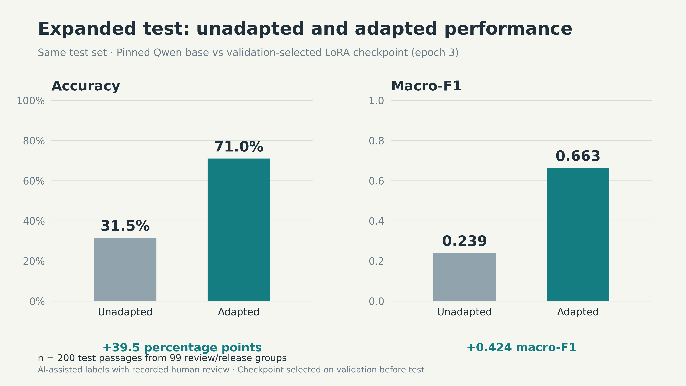

# Music Review Insight Finder

This ADS 509 Option 1 project adapted a small language model to classify music-review passages as **specific musical observation**, **general opinion**, or **background/other**. These are content categories. VADER provided a separate sentiment analysis.

The project has two phases. The prototype established the pipeline and explored training settings. The expanded evaluation then retained that work and tested a fresh adaptation with more reviewed examples.

## Result at a glance

On the same **200 held-out passages from 99 review/release groups**, adaptation improved accuracy from **31.5% to 71.0%** and macro-F1 from **0.2390 to 0.6630**. Labels were AI-assisted with human review; this is not an independent human-gold benchmark.



The practical goal is to help readers find concrete discussion of musical details within longer reviews. The project demonstrates collection, passage preparation, model adaptation, and evaluation as an inspectable workflow. It has not measured reader time savings or deployed a production search tool.

## Start here

1. Read [notebook 11](notebooks/11_music_review_EXPANDED_B_RESULTS_READABLE.ipynb) for the expanded dataset, training record and final test comparison. Its saved code and outputs are preserved.
2. Read [notebook 10](notebooks/10_saved_results_review_readable.ipynb) for the earlier prototype experiments and their saved results.
3. Open the [expanded evidence guide](expanded_evaluation/README.md) for the frozen data, helpers, prediction files and figures.
4. Read [data preparation](notebooks/02_data_preparation_readable.ipynb) and [training-only VADER EDA](notebooks/09_vader_sentiment_readable.ipynb) for the earlier collection and analysis.

The training notebooks document completed GPU runs. Read their saved outputs before running code. Re-executing notebook 11 installs packages, uploads data and starts a new GPU experiment; it is not needed to inspect the results.

## Phase 1: prototype

The [CritiqueBrainz API](https://critiquebrainz.org/ws/1/review/) collection contained 500 English release-group reviews. Preparation produced 7,664 passages after 217 short-passage exclusions and 20 exact duplicates. The bounded oldest-first sample and source attribution are retained in [ATTRIBUTION.csv](data/ATTRIBUTION.csv). Source reviews retain their CC BY-NC-SA 3.0 notices; see [third-party notices](THIRD_PARTY_NOTICES.md) before reuse.

The prototype used 140 training passages, 33 validation passages and 35 historical test passages. Its final labels received a nonblinded AI audit after the original human review. They are not independent human gold; the saved `human_accepted_audit` flag is false.

| Run | Configuration | Selected epoch | Validation accuracy | Validation macro-F1 |
|---|---|---:|---:|---:|
| A | Unweighted loss | 1 | 0.545455 | 0.305367 |
| B | Weighted loss, learning rate 0.0002, three epochs | 2 | 0.575758 | 0.464881 |
| C | Weighted loss, learning rate 0.0001, three epochs | 3 | 0.515152 | 0.423016 |
| D | Fresh weighted run, learning rate 0.0001, five epochs and changed schedule | 5 | 0.575758 | 0.461871 |

These are historical development results. Repeated use of the small validation set limits their interpretation. The old test set was already viewed in run 06 and was not used for the expanded comparison. The 0.3054 adapted run-06 reference is not an unadapted baseline.

VADER described the original 140 training passages: 26 negative scores, 36 exactly zero and 78 positive, with mean compound 0.258247. These sign groups use <0, ==0 and >0; a zero score does not establish a neutral opinion. This EDA was added after prototype model selection.

## Phase 2: expanded evaluation

The expanded dataset contained **400 training, 200 validation and 200 test passages**, from 180, 99 and 99 review/release groups. The original 140 training rows were retained. Aaron reviewed the 660 new usable labels after AI proposals. Labels are **AI-assisted with human review**, not independent human annotations.

New candidates excluded 229 groups exposed in earlier supervised work and diagnostics. Split membership was fixed before label drafting. The source corpus had already been used for unsupervised EDA; the expansion was not a new collection.

One fresh B-configuration LoRA run used `Qwen/Qwen2.5-0.5B-Instruct`, learning rate 0.0002 and three epochs. Validation selected epoch 3, with macro-F1 0.562990. Of 150 attempted optimizer updates, 148 succeeded and two were skipped in epoch 1. The selected checkpoint passed reload verification before test access.

Both models then scored the **same 200 test passages from 99 groups**:

| Model | Test accuracy | Test macro-F1 |
|---|---:|---:|
| Unadapted pinned base | 31.5% | 0.238963 |
| Adapted epoch-3 checkpoint | **71.0%** | **0.662959** |

The adapted model classified 142 passages correctly. The difference was 39.5 percentage points in accuracy and 0.423996 macro-F1. This comparison measures adaptation on this test set. Comparing it with prototype scores does not isolate the effect of adding data: the splits, group coverage and evaluation conditions differ.

General-opinion recall remained **50%** (27 of 54). Future work should add more varied training examples and clarify the guidelines for passages mixing opinion, musical detail and background. Any new experiment should define its evaluation plan first and use a new untouched test set. These test outcomes did not trigger retraining or checkpoint reselection.

The passages are clustered by source group. Subjective labels, passage boundaries, the bounded source sample and possible model pretraining overlap limit generalization. Restricted A/B/C scores are not calibrated confidence. The project did not measure business time savings.

## Files and reproduction

| Location | Contents |
|---|---|
| [notebooks](notebooks/) | Readable data preparation, VADER, prototype results and expanded results. |
| [notebooks/training](notebooks/training/) | Preserved executed prototype training notebooks 06, 07 and 08. |
| [expanded_evaluation](expanded_evaluation/) | Frozen 400/200/200 data, exact staged input archives, matching helpers and compact saved results. |
| [presentation_evidence/expanded_evaluation](presentation_evidence/expanded_evaluation/) | Same-test comparison, named confusion matrix and per-class metrics in PNG/SVG, with CSV/JSON sources and provenance. |
| [presentation_evidence](presentation_evidence/) | Historical prototype figures and their source checks. |
| [music_review_runs](music_review_runs/) | Original normalized collection cache, 500 reviews, 7,664 passages and prototype split files. |
| [music_review_pipeline.py](music_review_pipeline.py), [music_review_training.py](music_review_training.py) | Original collection, preparation, metrics and training helpers. |
| [labeling_server_v1.py](labeling_server_v1.py), [historical_preparation](historical_preparation/) | Earlier labeling interface and preparation helpers. |
| [inputs](inputs/) | Three immutable prototype input archives. |
| [results](results/) | Prototype aggregates, predictions, settings, histories and diagnostics. |
| [09_training_sentiment_EDA_VADER](09_training_sentiment_EDA_VADER/) | Reproducible training-only VADER analysis and saved outputs. |
| [data/ATTRIBUTION.csv](data/ATTRIBUTION.csv), [THIRD_PARTY_NOTICES.md](THIRD_PARTY_NOTICES.md) | Source attribution and data/model notices. |
| [docs](docs/) | Reproduction, upload guidance and the historical presentation outline. |
| [scripts](scripts/), [tests](tests/), [packaging](packaging/) | Offline checks, figure renderer, tests, hashes and integration history. |

### Set up local review

Clone this repository and run the following from its root with a Python 3.9 interpreter. The recorded analysis environment used **Python 3.9.19** and the versions in [requirements-local.txt](requirements-local.txt). Installation requires network access; the evidence checks below run without a model, GPU, or network calls.

```bash
git clone https://github.com/aaroncgabriel-12/ADS509-Final-Project.git
cd ADS509-Final-Project
python3.9 -m venv .venv
source .venv/bin/activate
python -m pip install -r requirements-local.txt
```

On Windows, activate with `.venv\Scripts\activate` instead. GitHub displays the saved notebooks directly, so local execution is optional for reviewing the findings.

### Check saved evidence

```bash
python scripts/verify_submission.py
python scripts/verify_expanded_evaluation.py
```

To regenerate figures from saved predictions and metrics:

```bash
python scripts/render_expanded_evidence.py --output outputs/expanded_presentation_evidence
```

The VADER notebook requires the separately acquired NLTK lexicon. GPU reproduction uses the pinned Colab environment and exact archives described in [REPRODUCTION.md](docs/REPRODUCTION.md) and the [expanded guide](expanded_evaluation/README.md). Checkpoints and full result archives are not distributed here; the saved notebooks, inputs, helpers, and predictions document the recorded runs. This documentation update did not retrain or reevaluate a model.

## AI assistance

Codex assisted with code, proposed labels, assisted the approved browser execution, and helped verify and explain results. Aaron reviewed the 660 new labels and approved the frozen data and run. Notebook 10 describes prototype assistance; notebook 11 records expanded-run assistance. Codex also assisted with this portfolio documentation update. These records do not establish a separate personal attestation that Aaron reviewed and understands all final code.

## Repository and coursework status

This is the published portfolio repository. Older packaging manifests and planning material record preparation-time state. They are retained as provenance and do not describe current publication or coursework completion. The historical outline is not a finished presentation. Video delivery, instructor access, and Canvas submission are separate activities whose completion is not established by this repository.
